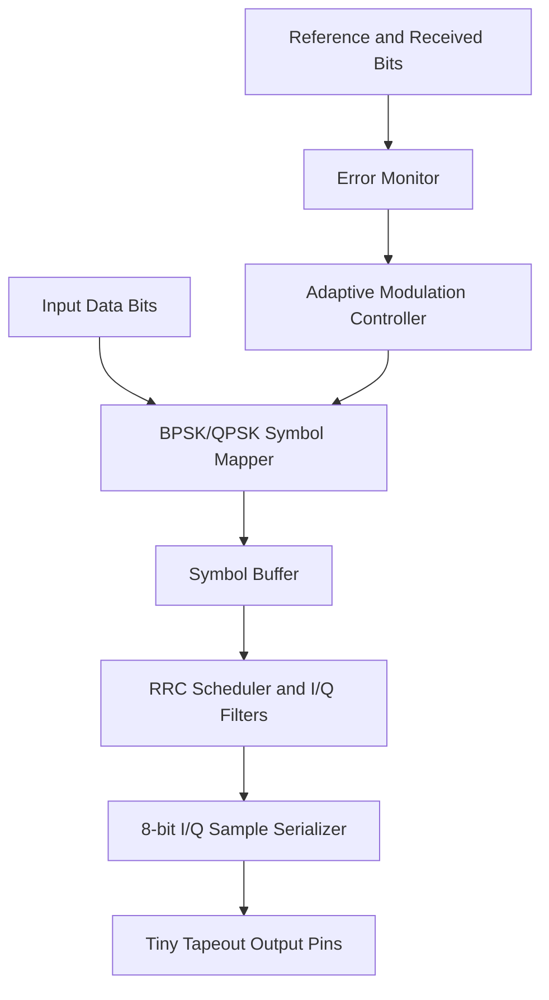

# Adaptive BPSK/QPSK Modulator with RRC Pulse Shaping

[](https://github.com/fanitsob/adaptive-bpsk-qpsk-tinytapeout/actions/workflows/gds.yaml)
[](https://github.com/fanitsob/adaptive-bpsk-qpsk-tinytapeout/actions/workflows/test.yaml)
[](https://github.com/fanitsob/adaptive-bpsk-qpsk-tinytapeout/actions/workflows/docs.yaml)

**A digital adaptive modulation ASIC designed for Tiny Tapeout using SystemVerilog and the Sky130 technology.**

- **Author:** Fani Tsompani
- **Technology:** Sky130
- **Design flow:** RTL-to-GDS using OpenLane
- **Tiny Tapeout tile:** 1×1
**Configured clock frequency:** 50 MHz

---

## 1. Project Overview

This project implements a digital adaptive BPSK/QPSK modulator with Root-Raised-Cosine (RRC) pulse shaping.

The design combines:

- BPSK and QPSK symbol mapping
- Bit-error monitoring
- Adaptive modulation selection
- Fixed-point RRC pulse shaping
- I/Q signal generation
- Symbol buffering and flow control
- Serialized 8-bit I/Q sample output

The modulation mode is selected automatically based on an externally supplied bit-error comparison stream.

The design has been functionally verified and processed through a Sky130 RTL-to-GDS flow.

## 2. System Architecture

The main functional blocks are:



### BPSK/QPSK Symbol Mapper

The symbol mapper generates digital in-phase (I) and quadrature (Q) symbol values.

- **BPSK:** One input bit determines the I symbol; Q is zero.
- **QPSK:** Two input bits determine the I and Q symbols.

The mapper uses registered outputs and provides a symbol-valid signal.

### Error Monitor

The error monitor compares externally supplied reference and received bits.

It counts bit mismatches over observation windows of 128 valid comparisons.

The resulting error count is used by the adaptive modulation controller.

### Adaptive Modulation Controller

The controller selects the modulation scheme according to the observed error count.

| Errors per window | Controller response |
|---|---|
| 0–2 | Two consecutive low-error windows are required to select QPSK |
| 3–7 | Retain the current mode and cancel pending low-error confirmation |
| 8 or more | Select BPSK |

The controller starts in BPSK mode after reset.

## 3. Root-Raised-Cosine Pulse Shaping

The design includes two digital RRC filters, one for the I channel and one for the Q channel.

### Filter Parameters

| Parameter | Value |
|---|---|
| Filter type | Root-Raised-Cosine |
| Number of taps | 25 |
| Roll-off factor | 0.35 |
| Samples per symbol | 4 |
| Filter span | 6 symbols |
| Output representation | Signed 8-bit |
| Implementation | Fixed-point polyphase FIR |

The filter processes ternary symbol values (-1, 0, +1).

Because the symbol values are restricted to these three possibilities, the FIR datapath uses addition, subtraction and bypass operations rather than general-purpose multipliers.

The I and Q sample streams are serialized onto a shared 8-bit output bus.

## 4. Symbol Buffering and Stream Control

A dedicated symbol buffer and stream scheduler coordinate incoming symbols and RRC sample generation.

The design supports:

- Symbol flow control using a ready signal
- Correct handling of gaps between input symbols
- Continuous symbol streams at the supported processing rate
- RRC filter-tail flushing after the final symbol
- Overflow detection

The RRC datapath generates four samples per symbol for each I/Q channel pair, serialized over eight clock cycles.

## 5. Tiny Tapeout Interface

The design supports two operating modes selected by `ui_in[7]`.

### Legacy Mode (`ui_in[7] = 0`)

The original digital symbol mapping and error-monitor outputs are available.

### RRC Mode (`ui_in[7] = 1`)

The RRC sample stream is available through the eight bidirectional pins, configured as outputs.

| Pin | Function in RRC mode |
|---|---|
| `ui_in[1:0]` | Input data bits |
| `ui_in[2]` | Reference bit |
| `ui_in[3]` | Received bit |
| `ui_in[4]` | Input symbol valid |
| `ui_in[5]` | Bit comparison valid |
| `ui_in[6]` | Clear error monitor |
| `ui_in[7]` | Enable RRC output mode |
| `uo_out[0]` | I symbol sign |
| `uo_out[1]` | Q symbol sign |
| `uo_out[2]` | Mapper symbol valid |
| `uo_out[3]` | Modulation mode |
| `uo_out[4]` | Symbol buffer ready |
| `uo_out[5]` | Buffer overflow indication |
| `uo_out[6]` | RRC sample valid |
| `uo_out[7]` | Sample channel (0 = I, 1 = Q) |
| `uio_out[7:0]` | Signed 8-bit RRC sample |

The legacy and RRC modes share the same physical interface.

For the complete pin description, see [info.yaml](info.yaml).

## 6. Functional Verification

The project includes SystemVerilog and Cocotb testbenches.

The verification covers:

- Adaptive modulation decisions
- BPSK and QPSK symbol mapping
- RRC impulse response
- Multi-symbol RRC convolution
- I/Q sample generation and serialization
- Continuous symbol streaming
- Symbol buffering and overflow detection
- BPSK/QPSK mode alignment
- Bursts with different symbol spacing
- Correct filter-tail flushing

Additional regression tests compare the generated RRC samples against a Python convolution reference.

The regression suite includes:

- BPSK and QPSK burst testing
- Symbol intervals of 8, 16 and 24 clock cycles
- A 60-symbol ready/valid flow-control test
- Modulation-mode alignment testing

### Running the Tests

To run the Cocotb tests:

```bash
cd test
make
```

To run the RRC regression suite from the project root:

```bash
bash test/rrc_regression/run.sh
```

The RRC regression tests require Icarus Verilog and the Python dependencies listed in `test/requirements.txt`.

## 7. Physical Design and Verification Results

The project uses the Tiny Tapeout digital ASIC flow targeting the Sky130 technology.

The following automated checks completed successfully:

| Verification step | Result |
|---|---|
| RTL functional simulation | PASS |
| RRC regression tests | PASS |
| Sky130 GDS generation | PASS |
| Tiny Tapeout precheck | PASS |
| Gate-level simulation | PASS |
| Documentation workflow | PASS |

The GitHub Actions workflows provide the corresponding build and verification logs.

[View GitHub Actions](https://github.com/fanitsob/adaptive-bpsk-qpsk-tinytapeout/actions)

Successful GDS generation does not imply that the design has already been fabricated.

## 8. Scope and Limitations

This project implements a digital transmit-side modulation and pulse-shaping architecture.

It does not include:

- An analog RF transmitter or DAC
- An integrated RF receiver
- An autonomous channel-quality estimator

The adaptive controller uses externally supplied bit-error comparisons.

The QPSK I/Q amplitudes are not normalized to the same total symbol energy as BPSK. Therefore, equal-power BER improvement from adaptive switching has not been demonstrated.

Potential future work includes constant-energy normalization and system-level BER-versus-SNR evaluation.

## 9. Project Files

| Directory or file | Description |
|---|---|
| `src/` | SystemVerilog RTL modules |
| `test/` | Cocotb and SystemVerilog verification |
| `test/rrc_regression/` | Automated RRC streaming regression tests |
| `docs/info.md` | Detailed project documentation |
| `info.yaml` | Tiny Tapeout project configuration |
| `src/config.json` | Physical-design flow configuration |
| `.github/workflows/` | Automated CI workflows |

For more information, see the [detailed project documentation](docs/info.md).

---

**Developed by Fani Tsompani**

- Electrical and Computer Engineering
- Democritus University of Thrace, Greece